| title | Handbrake-DIY |
| --- | --- |
| author | GLOXIOU |
| description | A DIY project for a simeracing handbrake, print in 3D and controlled by a ESP32.
| created_at | 2026-10-18 |

# Day 1: Defining system & idea search & inspiration

I want to make a simeracing handbrake, print in 3D, and controlled by a ESP32. The handbrake will have a litlle support so I can hang it up to my current support for my wheele. And the 3D part need to be bellow 256mm, because I will print it on a Bambulab A1.

My inspiration is the Laroal 64-bit USB Handbrake. I want to make that, but for much cheaper, and a litlle bit smaller. The only thing I want to keep from that housing is his shape.

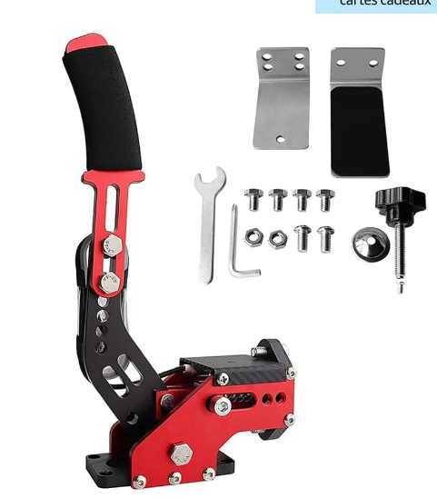

So, here is an initial list of the equipment needed for the project which, of course, is still subject to change:

| Component | Price |
| --- | --- |
| [ESP-32 S3](https://fr.aliexpress.com/item/1005008809316571.html?spm=a2g0o.cart.0.0.548d378dNH9kOS&mp=1&pdp_npi=6%40dis%21USD%21USD+8.93%21USD+8.93%21%21USD+8.93%21%21%21%400b5e1a3817923130709475572e0eae%2112000046760012013%21ct%21FR%218054027548%21%211%210%21&pdp_ext_f=%7B%22cart2PdpParams%22%3A%7B%22pdpBusinessMode%22%3A%22retail%22%7D%7D&gatewayAdapt=glo2fra) | 8.93$ |
| [WH148 15mm 10K](https://fr.aliexpress.com/item/1005006982762711.html?spm=a2g0o.productlist.main.1.197e3edeJYxCHA&algo_pvid=f94c3114-cbe6-4de2-8d58-85370a840220&algo_exp_id=f94c3114-cbe6-4de2-8d58-85370a840220-0&pdp_ext_f=%7B%22order%22%3A%221994%22%2C%22eval%22%3A%221%22%2C%22orig_sl_item_id%22%3A%221005006982762711%22%2C%22orig_item_id%22%3A%221005006213044445%22%2C%22fromPage%22%3A%22search%22%7D&pdp_npi=6%40dis%21USD%213.18%213.18%21%21%2121.18%2121.17%21%402161390617923146960198400e0fe5%2112000038936657843%21sea%21FR%218054027548%21X%211%210%21n_tag%3A-29911%3Bd%3A8484f755%3Bm03_new_user%3A-29895&curPageLogUid=LIIvkVuM1vlX&utparam-url=scene%3Asearch%7Cquery_from%3A%7Cx_object_id%3A1005006982762711%7C_p_origin_prod%3A1005006213044445) | 3.86$ |
| [Springs](https://fr.aliexpress.com/item/1005003386795893.html?spm=a2g0o.productlist.main.2.6e862458LRFzBi&algo_pvid=81b760a6-ee4f-43ec-b65e-82b657dbee44&algo_exp_id=81b760a6-ee4f-43ec-b65e-82b657dbee44-1&pdp_ext_f=%7B%22order%22%3A%2227%22%2C%22spu_best_type%22%3A%22price%22%2C%22eval%22%3A%221%22%2C%22fromPage%22%3A%22search%22%7D&pdp_npi=6%40dis%21USD%214.51%214.51%21%21%214.51%214.51%21%400b15831117923148933946859e0cf3%2112000025541020499%21sea%21FR%218054027548%21X%211%210%21n_tag%3A-29911%3Bd%3A8484f755%3Bm03_new_user%3A-29895&curPageLogUid=1MjvOHPb86G8&utparam-url=scene%3Asearch%7Cquery_from%3A%7Cx_object_id%3A1005003386795893%7C_p_origin_prod%3A) | 7.08$ |
| Total | 19.87$ |

The spring is a compression springs, length 30mm, wire diameter 1.2mm, outer diameter 10mm.
To that, you need to have 1 screw M6×35 mm; 1 M6 lock nut (with nylon insert); 2 M6 washers; 1 M5 × 40 mm screw; 2 M5 nuts; 2 M5 washers. Don't buy it online, in a local store that will be much cheaper !

Now here's a litlle plan to see where is it going:

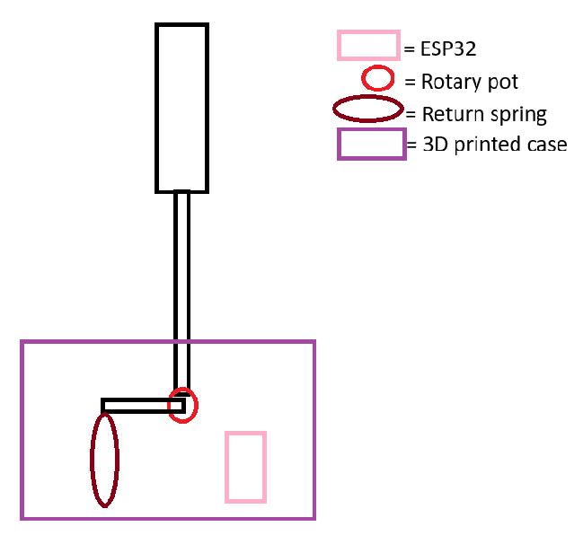

**Total time spent: 2 hours**

# Day 2: 3D Modelling

Today, I'm in vacacion so I have a lot of time to make the case. So it's just need to be small, and usable, and easy.

So I created the folder for the 3D files, you can check it [just here](3D-files). After that, I lunched Fusion 360, and started modeling.

The first thing I made was the base of the case, where all the componments will be. It's 160x62mm.

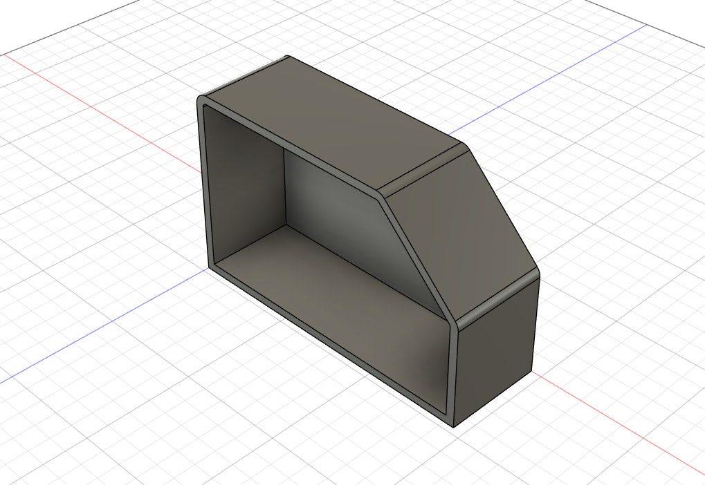

Then, I made all the wholes and support for the screws, and others thinngs. I also added 2 litlle support thing on the two sides; So the height is changed.

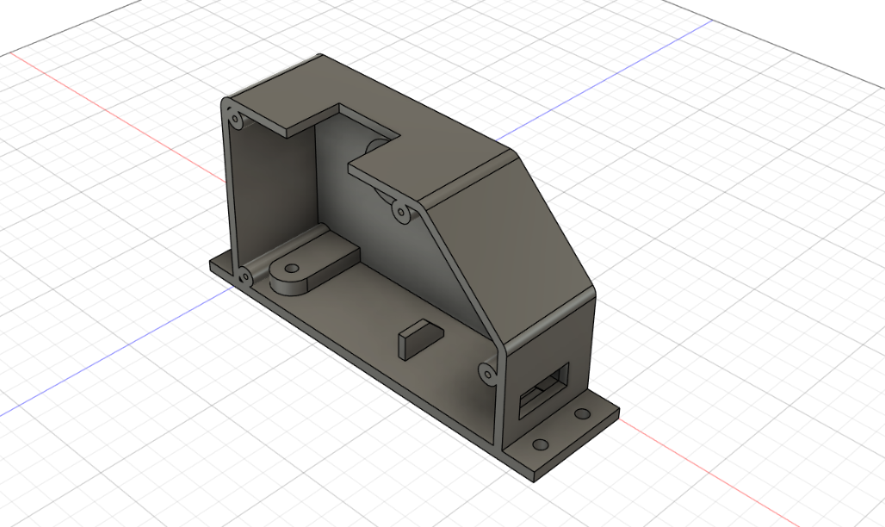

Next I made the actual handbrake in one piece, with the whole for the potentiometer.

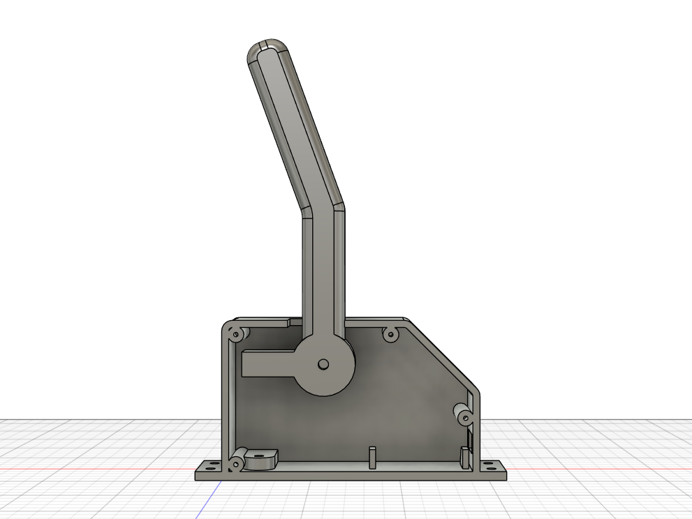

After that, I made the side cover, with a litlle cover for the potentiometer and his cable that was exposed like on the first picture. There's also two wholes to clip the cover.

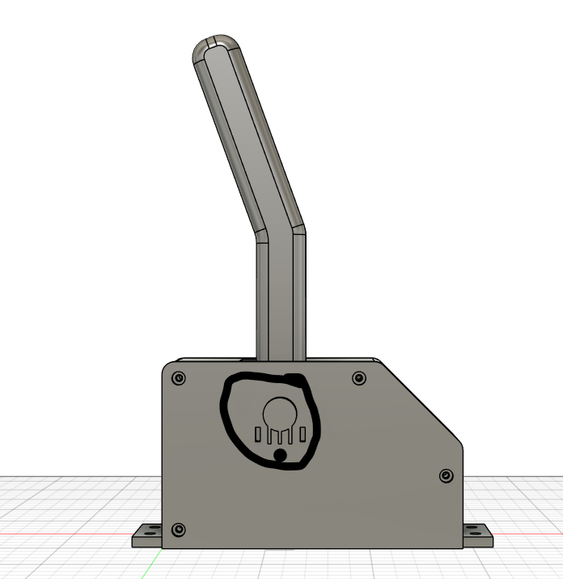
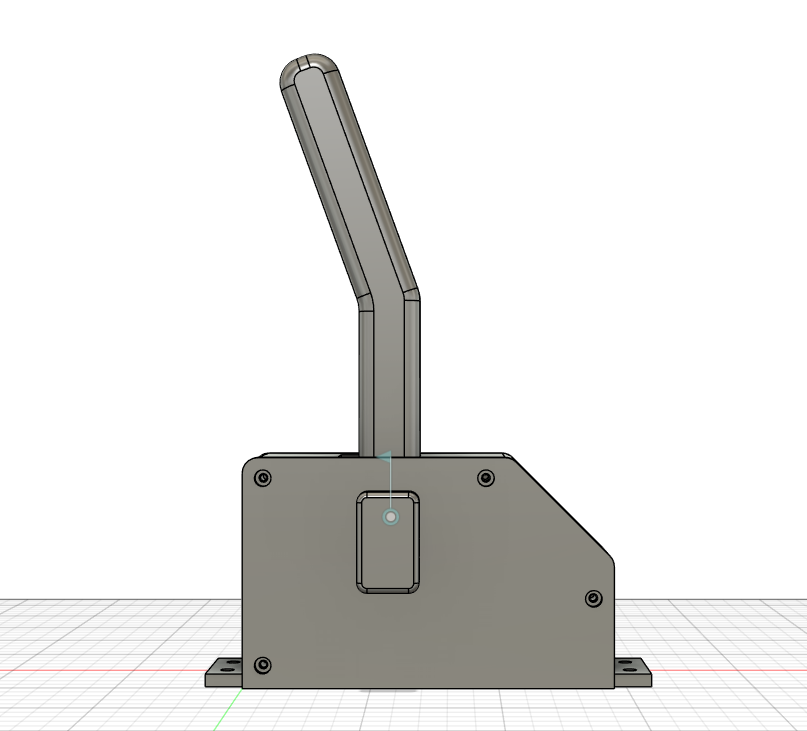

And then, I made the assembly with the ESP, the screws, the potentiometer and the spring. So here's the final look of the model:

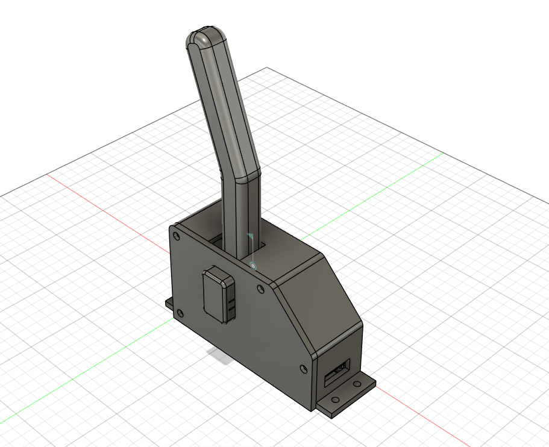

Position 1 - Normal position when the handbrake is not engaged:

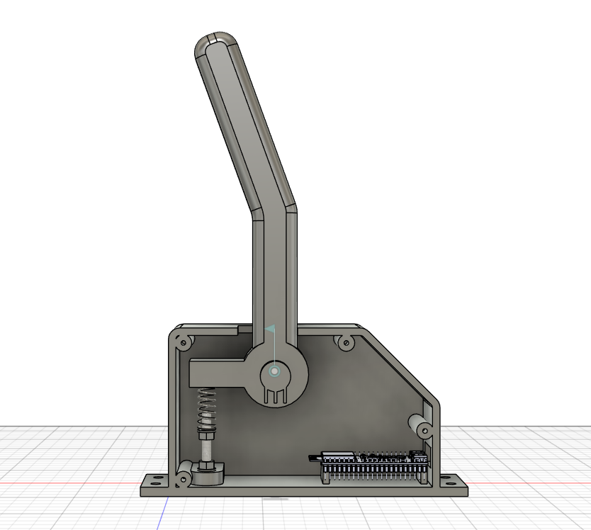

Position 2 - Position when the handbrake is engaged:

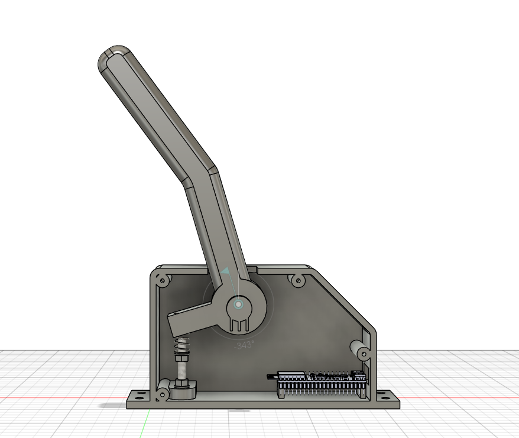

So, all that’s left to do is the code and the README, which I plan to tackle tomorrow.

The case is 175mm by 249 by 62, and the support is adjustable kinda.

I know I didn’t write much in the log today, but I spent the whole day doing a lot of modeling. You can check the printable file [here](3D-files/to%20print/), and the step and assembly file [here](3D-files).

**Total time spent: 5 hours**

# Day 3: Firmware and README

Hey ! So today I just need to do the firmware, wich will not take a while, and after that I will be able to make the README.

SO I started by making a wiring diagram to make firmware development easier:

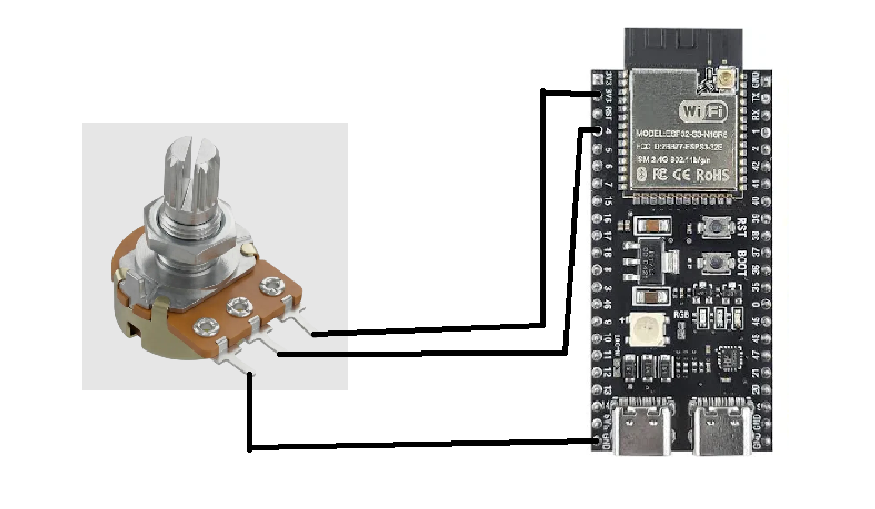

Then, I started the code. So, there’s nothing too complicated here, it includes features like calibration triggered by pressing the "boot" button with the values ​​stored directly on the ESP. The program is also recognized by games as a game controller.

I was able to compile the code and test it on an ESP32 I had at home, using a potentiometer (which wasn't the right size, but served the purpose for testing), and it works perfectly !

The code really didn't take long to put together, nor was it complex—it only took about an hour to write and test everything...

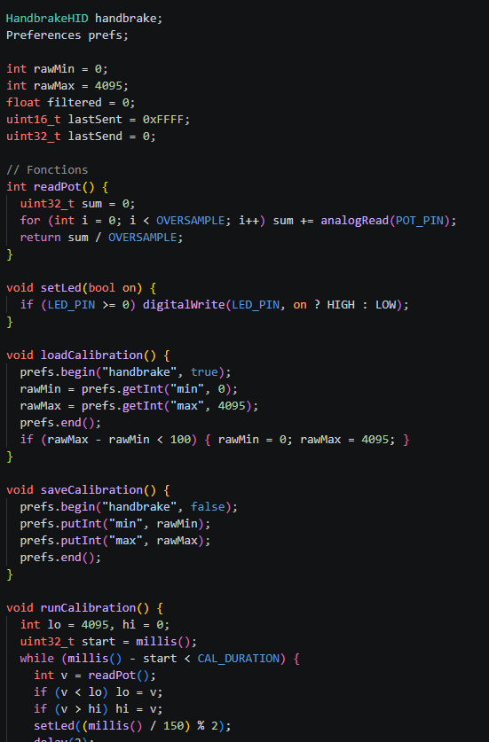

Here's the [file](firmware.ino) for the firmware.

After that I made the README that you can check just [here](README.md).
And the [BOM](BOM.csv), just copy and paste the table I had already created in the journal.

And afetr a bit of a verification for all the project, it's finished ! The thing that taked the most of the time was the 3D modeling...

**Total time spent: 2.5 hours**