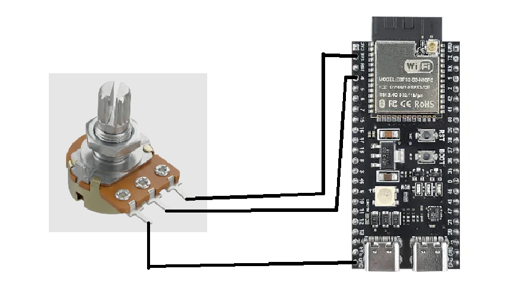
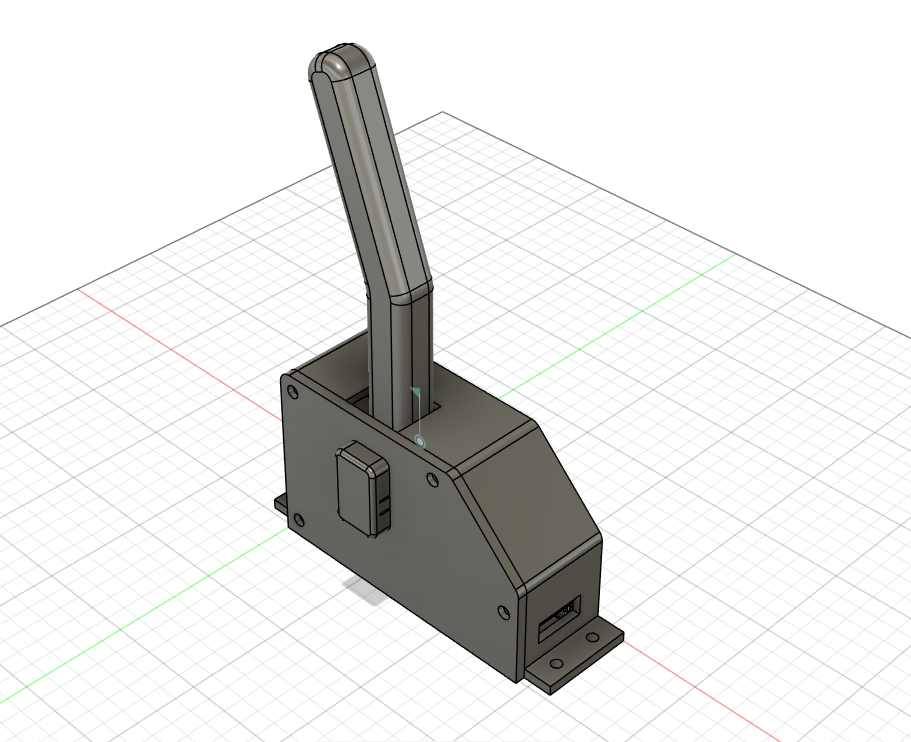
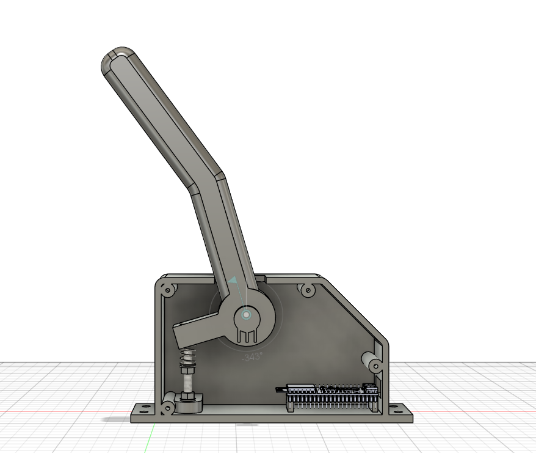

# Handbrake-DIY
A DIY project for a simeracing handbrake, print in 3D and controlled by a ESP32.

The project is designed to work with all of the game, be small and with an adjustable support.

The goal is to not pay hundred of dollars on a already existing product, and learn ! The HandBrake is also modifiable, ajustable, if anyone want to make it at home.

---

## Features

* Sturdy long handle
* Adjustable support
* Litlle form-factor
* Usable in all games
* Simple calibration using a button

And the design is made to be upgradable/updatable easely if necessery, so it will be able to last over time.

---

## Architecture

The ESP32-S3 is the central processor of the system. It handles communication via USB, and communication with the potentiometer to obtain the handbrake value. The WH148 potentiometer sends back the percentage value for how far the handbrake is pulled.The most important part is mechanical, involving screws and springs that make it possible to create a realistic object.

---

## Hardware and BOM

The current design uses the following main components:

| Component | Price |
| --- | --- |
| [ESP-32 S3](https://fr.aliexpress.com/item/1005008809316571.html?spm=a2g0o.cart.0.0.548d378dNH9kOS&mp=1&pdp_npi=6%40dis%21USD%21USD+8.93%21USD+8.93%21%21USD+8.93%21%21%21%400b5e1a3817923130709475572e0eae%2112000046760012013%21ct%21FR%218054027548%21%211%210%21&pdp_ext_f=%7B%22cart2PdpParams%22%3A%7B%22pdpBusinessMode%22%3A%22retail%22%7D%7D&gatewayAdapt=glo2fra) | 8.93$ |
| [WH148 15mm 10K](https://fr.aliexpress.com/item/1005006982762711.html?spm=a2g0o.productlist.main.1.197e3edeJYxCHA&algo_pvid=f94c3114-cbe6-4de2-8d58-85370a840220&algo_exp_id=f94c3114-cbe6-4de2-8d58-85370a840220-0&pdp_ext_f=%7B%22order%22%3A%221994%22%2C%22eval%22%3A%221%22%2C%22orig_sl_item_id%22%3A%221005006982762711%22%2C%22orig_item_id%22%3A%221005006213044445%22%2C%22fromPage%22%3A%22search%22%7D&pdp_npi=6%40dis%21USD%213.18%213.18%21%21%2121.18%2121.17%21%402161390617923146960198400e0fe5%2112000038936657843%21sea%21FR%218054027548%21X%211%210%21n_tag%3A-29911%3Bd%3A8484f755%3Bm03_new_user%3A-29895&curPageLogUid=LIIvkVuM1vlX&utparam-url=scene%3Asearch%7Cquery_from%3A%7Cx_object_id%3A1005006982762711%7C_p_origin_prod%3A1005006213044445) | 3.86$ |
| [Springs](https://fr.aliexpress.com/item/1005003386795893.html?spm=a2g0o.productlist.main.2.6e862458LRFzBi&algo_pvid=81b760a6-ee4f-43ec-b65e-82b657dbee44&algo_exp_id=81b760a6-ee4f-43ec-b65e-82b657dbee44-1&pdp_ext_f=%7B%22order%22%3A%2227%22%2C%22spu_best_type%22%3A%22price%22%2C%22eval%22%3A%221%22%2C%22fromPage%22%3A%22search%22%7D&pdp_npi=6%40dis%21USD%214.51%214.51%21%21%214.51%214.51%21%400b15831117923148933946859e0cf3%2112000025541020499%21sea%21FR%218054027548%21X%211%210%21n_tag%3A-29911%3Bd%3A8484f755%3Bm03_new_user%3A-29895&curPageLogUid=1MjvOHPb86G8&utparam-url=scene%3Asearch%7Cquery_from%3A%7Cx_object_id%3A1005003386795893%7C_p_origin_prod%3A) | 7.08$ |
| Total | 19.87$ |

The spring is a compression springs, length 30mm, wire diameter 1.2mm, outer diameter 10mm.
To that, you need to have 1 screw M6×35 mm; 1 M6 lock nut (with nylon insert); 2 M6 washers; 1 M5 × 40 mm screw; 2 M5 nuts; 2 M5 washers. Don't buy it online, in a local store that will be much cheaper !

The complete component list is available in [BOM.csv](BOM.csv).

---

## Processing and memory

I selected the ESP32-S3 beacause the project require beacasue it has a bit of processing power for the USB communication, though not a huge amount. That’s why it’s better suited for the task than a Arduino.

It is responsible for:

* USB Comunication
* Communication with the potentiometer
* Saving calibration values
* Calibration and calibration button

All the data, save and other are stored in the internal storage system of the ESP32.

---

## Potentiometer

The HandBrake is designed with a WH148 module.

This is the simplest and least expensive solution available.

With a sufficiently long potentiometer, it will be perfect for achieving a level of realism that closely mirrors the real thing.

---

## Componments and enclosure

There is no PCB in this project, beacause it's not required. Here is all the componments include:

* ESP32-S3 x1
* WH148 x1

Here's a schema of the connection between all the componemnts:

The case is 175mm by 249 by 62, and the support is adjustable kinda. This include the height of the actual HandBrake

Here's a look at it:

Assembly file: [Handbrake-DIY.step](3D-files/Handbrake-DIY.step)

---

## Build guide

Everything you need to build the HandBrake from this README alone.

### Tools

* 3D printer (the parts fit on a 256 x 256 mm bed, e.g. Bambu Lab A1)
* Soldering iron and solder
* Wrenches/sockets for M5 and M6, screwdriver
* Computer with the [Arduino IDE](https://www.arduino.cc/en/software)
* A USB-C data cable

### Hardware

| Component | Quantity |
| --- | --- |
| [ESP-32 S3](https://fr.aliexpress.com/item/1005008809316571.html?spm=a2g0o.cart.0.0.548d378dNH9kOS&mp=1&pdp_npi=6%40dis%21USD%21USD+8.93%21USD+8.93%21%21USD+8.93%21%21%21%400b5e1a3817923130709475572e0eae%2112000046760012013%21ct%21FR%218054027548%21%211%210%21&pdp_ext_f=%7B%22cart2PdpParams%22%3A%7B%22pdpBusinessMode%22%3A%22retail%22%7D%7D&gatewayAdapt=glo2fra) | 1 |
| [WH148 15mm 10K](https://fr.aliexpress.com/item/1005006982762711.html?spm=a2g0o.productlist.main.1.197e3edeJYxCHA&algo_pvid=f94c3114-cbe6-4de2-8d58-85370a840220&algo_exp_id=f94c3114-cbe6-4de2-8d58-85370a840220-0&pdp_ext_f=%7B%22order%22%3A%221994%22%2C%22eval%22%3A%221%22%2C%22orig_sl_item_id%22%3A%221005006982762711%22%2C%22orig_item_id%22%3A%221005006213044445%22%2C%22fromPage%22%3A%22search%22%7D&pdp_npi=6%40dis%21USD%213.18%213.18%21%21%2121.18%2121.17%21%402161390617923146960198400e0fe5%2112000038936657843%21sea%21FR%218054027548%21X%211%210%21n_tag%3A-29911%3Bd%3A8484f755%3Bm03_new_user%3A-29895&curPageLogUid=LIIvkVuM1vlX&utparam-url=scene%3Asearch%7Cquery_from%3A%7Cx_object_id%3A1005006982762711%7C_p_origin_prod%3A1005006213044445) | 1 |
| [Springs - Length 30 mm, wire 1.2 mm, outer diameter 10 mm](https://fr.aliexpress.com/item/1005003386795893.html?spm=a2g0o.productlist.main.2.6e862458LRFzBi&algo_pvid=81b760a6-ee4f-43ec-b65e-82b657dbee44&algo_exp_id=81b760a6-ee4f-43ec-b65e-82b657dbee44-1&pdp_ext_f=%7B%22order%22%3A%2227%22%2C%22spu_best_type%22%3A%22price%22%2C%22eval%22%3A%221%22%2C%22fromPage%22%3A%22search%22%7D&pdp_npi=6%40dis%21USD%214.51%214.51%21%21%214.51%214.51%21%400b15831117923148933946859e0cf3%2112000025541020499%21sea%21FR%218054027548%21X%211%210%21n_tag%3A-29911%3Bd%3A8484f755%3Bm03_new_user%3A-29895&curPageLogUid=1MjvOHPb86G8&utparam-url=scene%3Asearch%7Cquery_from%3A%7Cx_object_id%3A1005003386795893%7C_p_origin_prod%3A) | 1 |
| Dupont wires (about 10cm) | 3 |
| M5 washers | 2 |
| M5 nuts and 40mm screws | 2 |
| M6 nuts | 1 |
| M6 35mm screw | 1 |
| M6 40mm screw | 1 |
| M6 lock nut (nylon insert) | 1 |

The screws, nuts and washers are cheaper in a local hardware store.

### 1. Print the parts

* Print the files from [3D-files/to print/](3D-files/to%20print/). Every part fits on a 256 x 256 mm bed.
* Suggested settings: PETG (or PLA), 0.2 mm layers, 4 walls, 30-40 % infill. The lever is the part that takes the most force, so lay it flat on the bed and keep at least 4 walls.
* The full assembly (to check how everything fits) is in [`Handbrake-DIY.step`](3D-files/Handbrake-DIY.step).

### 2. Wiring

Follow the diagram:

The potentiometer has 3 pins. Looking at the pins, the wiring is:

| Potentiometer pin | ESP32-S3 pin |
| --- | --- |
| One outer pin | 3V3 |
| Middle pin (wiper) | GPIO 4 |
| Other outer pin | GND |

### 3. Assembly

1. Solder the 3 wires to the potentiometer (see above) and connect them to the ESP32-S3.
2. Place the ESP32-S3 at the bottom right of the case, with its USB-C port facing the opening on the side of the case.
3. Install the potentiometer on the lever pivot, inside the case.
4. Assemble the spring guide: M5 x 40 screw, with a washer and a nut on each side of the bottom support of the case, and the compression spring around the screw. The spring pushes the back of the lever to bring it back to its rest position.
5. Fit the lever on its pivot with the M6 x 35 screw, the two M6 washers and the M6 lock nut. Tighten until there is no play, but the lever must still move freely.

### 4. Flash the firmware

No external library is needed.

Use the [Arduino IDE](https://www.arduino.cc/en/software).

Select your board, the ESP32-S3 on the good COM port.

### 5. Calibration

The values are stored in the flash memory of the ESP32, so you only need to do it once (and again if you move the potentiometer).

1. Plug the HandBrake on the USB port.
2. Press and hold the BOOT button for a moment (it is the calibration button, GPIO 0).
3. During the 5 seconds that follow, pull the lever from its rest position to its maximum position, then release it.
4. The new minimum and maximum values are saved automatically. If the movement was too small, the old values are kept: just start again.

### 6. Test and use in games

Just try it on your fav game !

You might need to invert the axe in the settings of the game.

### Configuration

The settings are at the top of [firmware.ino](firmware.ino):

| Setting | Default | Description |
| --- | --- | --- |
| POT_PIN | 4 | ESP32-S3 pin connected to the potentiometer |
| CAL_BTN_PIN | 0 | Calibration button (BOOT button of the board) |
| LED_PIN | -1 | Optional LED that blinks during calibration (-1 = disabled) |
| INVERT_AXIS | false | Invert the axis direction |
| DEADZONE_LOW / DEADZONE_HIGH | 0.02 | Dead zone at the start / end of the travel (2 %) |
| OVERSAMPLE | 16 | Number of ADC readings averaged for each measure |
| FILTER_ALPHA | 0.25 | Smoothing of the signal (lower = smoother but slower) |
| CAL_DURATION | 5000 | Duration of the calibration, in milliseconds |
| DEBUG_SERIAL | false | Print the raw values on the serial monitor (115200 baud) |

---

## Estimate cost

The current estimate is around $25 of components with the screws.
This does not include assembly, enclosure parts or future design changes, and print filament that I already have.

---

## Project journal

The development process is documented in [JOURNAL.md](JOURNAL.md)

It includes in-depth design, configuration, part of the code, enclosure design, BOM creation and the problems encountered during development.

---

## Inspiration and credits

The HandBrake DIY project was inspired by the Laroal 64-bit USB Handbrake.

The HandBrake DIY is an independent design developed from this inspiration.

Credits:
* Laroal 64-bit USB Handbrake — inspiration for the project concept and overall goal of creating an affordable HandBrake.
* GrabCAD community — some 3D component models were used as reference geometry for the CAD assembly. The original authors retain ownership of their respective models:
* ESP32-S3 — Main microcontroller platform.
* WH148 — Potentiometer.

All custom enclosure designs, assembly work, wiring, firmware, and project documentation were created as part of the HandBrake DIY project unless otherwise stated.